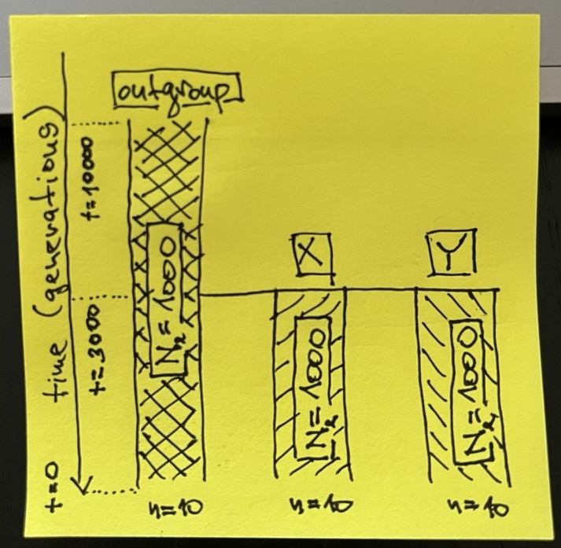

# Between-population statistics


## Theme of this chapter

In this chapter, we will move from computing "within-group" population genetic
statistics to "between-group" statistics. In a couple of practical exercises, we
will implement "recipes" showcasing how simulation-based exploration allows us
to characterize the expected behavior of statistics of interest under various
relevant demographic scenarios to confidently understand their strengths and
limitations. In the process, we will (re-)discover a couple of known features of
$F_{ST}$ and $f_3$ statistics highly relevant for practical research.


## Literature

- [Chapter 2.4, _"2.4 Genetic drift in structured
populations."_](https://web.stanford.edu/group/pritchardlab/HGbook/Release-2023-09/HGBook-2023-09-chapters/HGBook-2023-09-23-ch2.4.pdf):
As mentioned in the introduction, to do the exercises in this chapter, you don't
have to know more about $F_{ST}$ other than that it's a frequently useful metric
of genetic differentiation between two populations scaled between 0 (no
differentiation, i.e. both groups form a single panmictic population) to 1
(complete differentiation without any shared genetic variation betweeen the two
groups). Still, if you want to know a bit more about the technical details (and
many, many caveats) of $F_{ST}$, take a look at the linked chapter of the book
_"An Owner's Guide to the Human Genome"_, specifically section titled
_"Measuring population structure: FST"_.


- If you want to know much more technical background into $f_3$ statistics
(introduced in this chapter), and $f_4$ statistics and admixture proportion
estimators $f_4$-ratio (introduced in the following chapter), you can take a
look at the following papers: [Peter,
2016](https://academic.oup.com/genetics/article/202/4/1485/5930214), [Lipson
2020](https://onlinelibrary.wiley.com/doi/abs/10.1111/1755-0998.13230), and
[Patterson _et al._,
2012](https://academic.oup.com/genetics/article/192/3/1065/5935193).


## Exercise 1: Recap on working with R lists and nested vectors

In the previous chapter, you learned to compute within-group summary statistics
which is done by providing single vectors of individual names (most easily
obtained by the function `ts_names()`) to various _slendr_ functions in a very
straightforward way.

Whenever we work with "between-group statistics" (statistics based on
comparisons of genomic variation between different groups of individuals, also
known as ["multi-way
statistics"](https://tskit.dev/tskit/docs/stable/stats.html#multi-way-methods)in
_tskit_ which _slendr_ uses as an internal statistical computation engine), we
need to be aware of a couple of things with regards to how R handles nested
lists of vectors.

Let's first set up a small model to demonstrate this concept again and to
practice it in an easy-to-understand context.

---

**Start by creating a new R script called `split_simulation.R` and program the
three-population model (populations called "outgroup", "X", and "Y") in the
following sketch in this script. Simulate a tree sequence object `ts` (sequence
length 10Mb, recombination rate `1e-8`, mutation rate `1e-8`) from this model,
scheduling the recording of ten individuals from each of the three populations
at time 0 (i.e., the "present-day").**

<center>
{width=50%}
</center>

**Hint:** As a gentle reminder, unlike our previous toy examples, this model
features multiple populations, so you will need to program population splits.
Remember that you can specify that a population should split from some parent
lineage by using the `population(..., parent = <parent population>)` format.

::: {.callout-note collapse="true" icon=false}
### Click to see the solution

Here's what's in my `split_simulation.R` script:

```{r}
#| collapse: true
library(slendr)
init_env()

outgroup <- population("outgroup", N = 1000, time = 10000)
X <- population("X", N = 1000, time = 3000, parent = outgroup)
Y <- population("Y", N = 1000, time = 3000, parent = outgroup)

model <- compile_model(list(outgroup, X, Y), generation_time = 1)

schedule <- schedule_recording(model, times = 0, list("each", 10))

plot_model(model, order = c("outgroup", "X", "Y"), proportions = TRUE, schedule = schedule)

ts <-
  msprime(model, sequence_length = 10e6, recombination_rate = 1e-8, schedule = schedule) %>%
  ts_mutate(mutation_rate = 1e-8)
```

:::

---

Let's do a recap of a couple of vector- and list-based operations in R, which
are used in _slendr_ all the time (you can refresh your memory on this topic by
scrolling through the introductory [R bootcamp](r-bootcamp.html) chapter,
particularly sections about subsetting and indexing into vectors and lists).

**You're already familiar with calling the function `ts_names()` as
`ts_names(ts)` and know that it produces a plain vector of individual names.
Now, add the following line to your script:**

```{r}
samples <- ts_names(ts, split = TRUE)
```

**When you type `samples` in your R console, What is the type of the data stored
in it? What does this information tell us and how is it different from running
simply `ts_names(ts)`?**

::: {.callout-note collapse="true" icon=false}
### Click to see the solution

- The command `ts_names(ts)` produces a vector of all individuals recorded in
the tree sequence, as we can see here:

```{r}
samples <- ts_names(ts)
# samples is a "character vector"
class(samples)
samples
```

- The variation `ts_names(ts, split = TRUE)` gives us a (named! this is
important!) list of vectors, one for each population.

```{r}
samples <- ts_names(ts, split = TRUE)
# samples is a list
class(samples)
samples
```

:::

---

**Using operations for indexing and subsetting of R lists, how would you access
the names of individuals in the population X? Specifically, what's the
difference between calling `samples$X`, `samples[["X"]]`, and `samples["X"]`?
Try to answer first without running these commands, then run them in the R
console to verify your intuition.**

::: {.callout-note collapse="true" icon=false}
### Click to see the solution

- The first command extracts a "standalone" vector of X individuals from the
list:

```{r}
samples$X
length(samples$X)
```

- The same goes for the second variant:

```{r}
samples[["X"]]
length(samples[["X"]])
```

- The third command is very different. It looks the same, superficially, but
it's actually a list with a single element (the vector of names)!

```{r}
samples["X"]
length(samples["X"])
```

:::

---

Why does any of this matter?

Remember how in the previous chapter, you needed to specify a subset of
individuals in a slightly convoluted way in order to compute a statistic on
them, such as:

```{r}
list(group_name = c("X_1", "X_2", "X_3"))
```

Doing so for complex computations is very annoying. But also---notice how the
following command produces the same format of data as the above:

```{r}
samples["X"]
```

This is why I implemented the variant `ts_names(ts, split = TRUE)` in _slendr_,
as a shortcut for not having to deal with named lists of vectors. This makes it
possible to use the `samples` variable to instruct _slendr_ to perform more
complex multi-population calculations very efficiently.


## Exercise 2: "Outgroup" $f_3$ statistic

The $f_3$ statistic is a famous population genetic metric [formally established
by Nick Patterson and David
Reich](https://academic.oup.com/genetics/article/192/3/1065/5935193) in 2008. In
practice, the statistic is used in two formulations:

- as a measure of shared drift between two populations (also known as the
"outgroup" $f_3$ formulation), or

- as an admixture test (also known as the "admixture $f_3$" formulation,
something we'll look at later).

As the name implies, $f_3$ statistic involves the specification of three
different lineages (usually populations, or groups of samples from those
populations) often called A, B, and C in various mathematical equations, making
it a good starting example of how to compute multi-population statistics in
_slendr_

Let's develop a simulation-based model which will allow us to explore some
practically relevant features of this important summary statistic.

---

**Let's start by doing a couple of modifications to our script
`split_simulation.R`:**

1. **Wrap the code in a function called `simulate_split()` and update it so that
this function accepts a single argument `tsplit` and uses it to specify the
point at the "X" and "Y" populations split from the "outgroup" lineage**
(instead of having a fixed value for the split time as you have now).

2. **Add the computation of the outgroup $f_3$ statistic, using the function
`ts_f3()`, setting the "X" individuals as the `B =` argument, "Y" individuals as
the `C =` argument, and the `A =` argument to the "outgroup" individuals**
(remember to use the `samples` variable produced by `ts_names()` to do this).

3. **The function should return a data frame produced by the `ts_f3()` function,
with a new column named `tsplit` containing the value of this function
argument.**

As you see, this is similar to what we did in the previous chapter and over
time, you will recognize this as common pattern in simulation-based inference
and computer programming in general.

::: aside

**Note:** The $f_3$ statistic is traditionally expressed as $f_3(A, B; C)$,
where C represents the outgroup. Unfortunately, in _tskit_ the outgroup is named
A, with B and C being the pair of samples from which we trace the length of
branches towards the outgroup, so the statistic is interpreted as $f_3(B, C;
A).$

:::

::: {.callout-note collapse="true" icon=false}
### Click to see the solution

Here's the content of the script `split_simulation.R`:

```{r}
library(slendr)
init_env()

simulate_split <- function(tsplit) {
  outgroup <- population("outgroup", N = 1000, time = 10000)
  X <- population("X", N = 1000, time = tsplit, parent = outgroup)
  Y <- population("Y", N = 1000, time = tsplit, parent = outgroup)
  
  model <- compile_model(list(outgroup, X, Y), generation_time = 1)
  
  schedule <- schedule_recording(model, times = 0, list("each", 10))
  
  ts <-
    msprime(model, sequence_length = 10e6, recombination_rate = 1e-8, schedule = schedule) %>%
    ts_mutate(mutation_rate = 1e-8)

  samples <- ts_names(ts, split = TRUE)
  
  df <- ts_f3(ts, A = samples["outgroup"], B = samples["X"], C = samples["Y"])
  df$tsplit <- tsplit
  
  return(df)
}
```

:::

---

**Test your function `simulate_split()` by calling it on a few split time values
in your R console. When you're confident that you programmed the function
correctly, use the familiar function `map_dfr()` from the _purrr_ package to run simulations of split
times between 1 and 10000 generations in steps of every 1000 generations** (see
`?seq` for a reminder on how to do this). **Visualize the statistical expectation
of the $f_3$ statistic in a scatterplot as a function of the split time. Add all
this analysis code in your script `split_simulation.R` after your function
definition, so that you have it properly recorded as a reproducible pipeline.**

::: {.callout-note collapse="true" icon=false}
### Click to see the solution

Let's test the function first:

```{r}
simulate_split(tsplit = 1000)
simulate_split(tsplit = 2000)
simulate_split(tsplit = 5000)
```

Now we can run it on a grid of parameter values:

```{r}
library(purrr)
f3_outgroup <- map_dfr(seq(1, 10000, by = 1000), simulate_split)
```

We can verify that we did, indeed, get a tidy table of the expected $f_3$ values
for a range of possible split times by typing the result into the R console:

```{r}
f3_outgroup
```

And we can finally visualize our results:

```{r}
library(ggplot2)

ggplot(f3_outgroup, aes(tsplit, f3)) +
  geom_point() +
  geom_smooth(method = "lm", color = "red", linetype = "dashed") +
  geom_hline(yintercept = 0, linetype = "dashed") +
  coord_cartesian(xlim = c(0, 10000)) +
  ggtitle("Expected f3 value as a function of split time") +
  xlab("Split time [generations ago]")
```

We can see that, as expected, the $f_3$ statistic gives a nearly zero for the
model involving an extremely recent split of X and Y populations from the
outgroup lineage. As you'll see later, this is consistent with mathematical
theory which defined $f_3$ as the length of the shared branch of X and Y towards
the outgroup sample which is, in this case, almost nonexistent (only 1
generation long). To demonstrate this by visualizing such a model (which,
necessarily, looks a bit silly):

```{r}
#| echo: false
outgroup <- population("outgroup", N = 1000, time = 10000)
X <- population("X", N = 1000, time = 1, parent = outgroup)
Y <- population("Y", N = 1000, time = 1, parent = outgroup)

model <- compile_model(list(outgroup, X, Y), generation_time = 1)

schedule <- schedule_recording(model, times = 0, list("each", 10))

plot_model(model, order = c("outgroup", "X", "Y"), proportions = TRUE, schedule = schedule)
```

On the other hand, the older the split time from the outgroup, the longer the
shared branch is. Again, to demonstrate the "shared branch length" graphically
on a model with the split time of 9001 generations ago:

```{r}
#| echo: false
outgroup <- population("outgroup", N = 1000, time = 10000)
X <- population("X", N = 1000, time = 9001, parent = outgroup)
Y <- population("Y", N = 1000, time = 9001, parent = outgroup)

model <- compile_model(list(outgroup, X, Y), generation_time = 1)

schedule <- schedule_recording(model, times = 0, list("each", 10))

plot_model(model, order = c("outgroup", "X", "Y"), proportions = TRUE, schedule = schedule)
```

:::

With this initial setup out of the way, let's delve into using our small
simulation pipeline to answer a couple of practically relevant questions.


## Exercise 3: Statistical power of $F_{ST}$ vs outgroup $f_3$

Another statistic which is very frequently used as a measure of population
differentiation is [$F_{ST}$](https://en.wikipedia.org/wiki/Fixation_index).
Let's say we want to understand which of the two statistics ($f_3$ or $F_{ST}$)
is more robust to $N_e$ differences between the two populations under study.

Recall that $N_e$ determines the amount of genetic drift (and, therefore, the
rate of the loss of genomic variation) in a population. In other words, if you
were interested in measuring how far in the past two populations began
differentiating, would both of them give you a reliable answer, regardless of
the $N_e$ of those populations under study?

Both $F_{ST}$ and $f_3$ are routinely used as measures of population
differentiation---can we use them equivalently? Does one have potentially more
statistical power than the other? They are sometimes used quite interchangeably
in practical research---could it sometimes be a problem?

---

**We want to evaluate the impact of $N_e$, so let's modify our function
`simulate_split()` a little bit first:**

1. Right now the function accepts a single argument `tsplit`. **Add a second
argument to this function called `Ne`, then modify the two lines of code
programming the splits of `X` and `Y` populations from the `outgroup` and change
the fixed values of `N = 1000` to use the new flexible parameters `Ne`.**

2. **Modify the function so that it returns in the resulting data frame not only
containing the $f_3$ value (computed by `ts_f3()`) but also the $F_{ST}$ value
(computed by `ts_fst()`).** You can look up the help in `?ts_fst` to see how to
use this function.

3. **The data frame returned by the function should now include not only the
`tsplit` column (containing the value of the `tsplit` argument) as well as the
column `Ne` (containing the value of the `Ne` argument).**

**Finally, run the code for the function in your R console, then test it on a
couple of `tsplit` and `Ne` parameter values.**

::: {.callout-note collapse="true" icon=false}
### Click to see the solution

Here's how the modified function looks like. Hopefully this is starting to look
like a routine for you (because this is where we eventually want to get):

```{r}
simulate_split <- function(tsplit, Ne) {
  # create a generalized demographic model
  outgroup <- population("outgroup", N = 1000, time = 10000)
  X <- population("X", N = Ne, time = tsplit, parent = outgroup)
  Y <- population("Y", N = Ne, time = tsplit, parent = outgroup)
  model <- compile_model(list(outgroup, X, Y), generation_time = 1)
  
  # program recording of individuals from each model and simulate their
  # genomic sequences
  schedule <- schedule_recording(model, times = 0, list("each", 10))
  ts <- msprime(model, sequence_length = 10e6, recombination_rate = 1e-8, schedule = schedule) %>%
    ts_mutate(mutation_rate = 1e-8)

  # compute Fst and f3 statistics
  samples <- ts_names(ts, split = TRUE)
  value_fst <- ts_fst(ts, sample_sets = samples[c("X", "Y")])$Fst
  value_f3 <- ts_f3(ts, A = samples["outgroup"], B = samples["X"], C = samples["Y"])$f3

  # compose the resulting data frame
  df <- data.frame(statistic = c("Fst", "f3"), value = c(value_fst, value_f3))
  df$tsplit <- tsplit
  df$Ne <- Ne
  
  return(df)
}
```

And here's how we can check that the function works:

```{r}
simulate_split(tsplit = 3000, Ne = 100)
simulate_split(tsplit = 3000, Ne = 1000)
simulate_split(tsplit = 3000, Ne = 5000)
```

:::

---

**Now that you have your updated function tested, use it to program a new batch
of parameter grid simulations into your script pipeline using the looping
function `map_dfr()`, this time fixing `tsplit = 3000` and simulating the model
for the values of the $N_e$ parameter. You can use the following code:**

```{r}
# define values of the Ne parameter grid
Ne_grid <- c(100, seq(from = 1000, to = 10000, by = 1000))

# note that although our new function requires two arguments (Ne and tsplit),
# we can loop over one parameter (Ne), while fixing the other (tsplit)
df_tsplit3k <- map_dfr(Ne_grid, simulate_split, tsplit = 3000)
```

**When you're done, visualize the expected values of `f3` and `Fst` summary
statistics as functions of $N_e$ (and, therefore, as a function of the amount
of genetic drift).**

::: {.callout-note collapse="true" icon=false}
### Click to see the solution

```{r}
ggplot(df_tsplit3k, aes(Ne, value, color = statistic)) +
  geom_point() +
  geom_smooth() +
  facet_wrap(~ statistic, scales = "free_y") +
  theme(axis.text.x = element_text(angle = 45)) +
  geom_hline(yintercept = 0, linetype = "dashed") +
  ggtitle("Fst and f3 for X-Y split at 3000 generations ago, assuming given Ne")
```

Conclusion: the $f_3$ statistic really is an unbiased estimator of population
divergence with respect to $N_e$ of the two lineages. On the other hand,
$F_{ST}$ is not a great metric of a population split, even though it's sometimes
colloquially used in this phylogenetic sense.

However, to be fair, this is not surprising, because $F_{ST}$ measures
population _differentiation_! If the $N_e$ is huge, both `X` and `Y` lineages
can retain most of the genomic variation which arose in their ancestor (unless
they diverged a very long time ago). On the other hand, $f_3$ truly measures the
_shared branch length_ which is, by definition, accurately indicative of the
population divergence.

:::

---

**Now, program a second batch of the same grid simulations in your script below
the last batch, this time fixing `tsplit` to 9999 generations ago. What changes
when you visualize these new results in the same way as above, with regards to
the patterns shown by $f_3$ and $F_{ST}$?**

::: {.callout-note collapse="true" icon=false}
### Click to see the solution

We only need to rerun the simulation loop and visualise the results:

```{r}
df_tsplit10k <- map_dfr(Ne_grid, simulate_split, tsplit = 9999)
```

Here's a visualization of the new results:

```{r}
ggplot(df_tsplit10k, aes(Ne, value, color = statistic)) +
  geom_point() +
  geom_smooth() +
  facet_wrap(~ statistic, scales = "free_y") +
  theme(axis.text.x = element_text(angle = 45)) +
  geom_hline(yintercept = 0, linetype = "dashed") +
  ggtitle("Fst and f3 for X-Y split at 9999 generations ago, assuming given Ne")
```

When we compare both results side-by-side, we see the difference right away. The
split time at 3000 generations ago meant that, when the populations have large
$N_e$, they retain lots of shared genetic variation, leading to a very low
$F_{ST}$ (actually, consistent with zero) which indicates they are not
differentiated (upper row). However, the older the split time between the two
populations, the more genetic drift causes both "X" and "Y" to become
differentiated which is manifested by a higher $F_{ST}$ value even for very high
$N_e$:

```{r}
#| echo: false
cowplot::plot_grid(
ggplot(df_tsplit3k, aes(Ne, value, color = statistic)) +
  geom_point() +
  geom_smooth() +
  facet_wrap(~ statistic, scales = "free_y") +
  theme(axis.text.x = element_text(angle = 45)) +
  geom_hline(yintercept = 0, linetype = "dashed") +
  ggtitle("Fst and f3 for X-Y split at 3000 generations ago, assuming given Ne"),

ggplot(df_tsplit10k, aes(Ne, value, color = statistic)) +
  geom_point() +
  geom_smooth() +
  facet_wrap(~ statistic, scales = "free_y") +
  theme(axis.text.x = element_text(angle = 45)) +
  geom_hline(yintercept = 0, linetype = "dashed") +
  ggtitle("Fst and f3 for X-Y split at 10000 generations ago, assuming given Ne"),

nrow = 2
)
```

Crucially, however, note that $f_3$ is completely robust to the amount of
genetic drift (i.e., the $N_e$ of the populations in question)---it always
measures the correct branch length, regardless of the $N_e$ in the assumed
model.

:::

## Catching up

Here is a complete solution to the exercises so far, represented by a single
reproducible R script `split_simulation.R`.

::: {.callout-note collapse="true" icon=false}
### Click to see the script `split_simulation.R`

```{r}
#| eval: false
#| message: false
#| collapse: true
#| output: false
library(slendr)
init_env()

library(dplyr)
library(ggplot2)
library(purrr)

# this is the second version of the function simulate_split() which accepts
# both tsplit and Ne as function arguments
simulate_split <- function(tsplit, Ne) {
  # set up the three-population demographic model
  outgroup <- population("outgroup", N = 1000, time = 10000)
  X <- population("X", N = Ne, time = tsplit, parent = outgroup)
  Y <- population("Y", N = Ne, time = tsplit, parent = outgroup)
  model <- compile_model(list(outgroup, X, Y), generation_time = 1)
  
  # simulate a tree sequence which will record a defined set of 25 individuals
  # from each population at the end of the simulation (i.e., "present-day")
  schedule <- schedule_recording(model, times = 0, list("each", 25))
  
  ts <-
    msprime(model, sequence_length = 10e6, recombination_rate = 1e-8, schedule = schedule) %>%
    ts_mutate(mutation_rate = 1e-8)

  # extract the list of names of individuals in each population for convenience
  samples <- ts_names(ts, split = TRUE)
  
  # compute both summary statistics and extract their values as single numbers
  value_fst <- ts_fst(ts, sample_sets = samples[c("X", "Y")])$Fst
  value_f3 <- ts_f3(ts, A = samples["outgroup"], B = samples["X"], C = samples["Y"])$f3

  # construct a data frame with all the necessary information
  df <- data.frame(statistic = c("Fst", "f3"), value = c(value_fst, value_f3))
  df$tsplit <- tsplit
  df$Ne <- Ne
  
  return(df)
}


# this is the original exploration of f3 as a function of split time, slightly
# tweaked to use the version of simulate_split() parametrizable by both
# tsplit and Ne (recall that the first version used only the tsplit argument)
f3_outgroup <- map_dfr(seq(1, 10000, by = 1000), simulate_split, Ne = 1000)

# and visualization of the results
f3_outgroup %>%
filter(statistic == "f3", Ne == 1000) %>%
ggplot(aes(tsplit, value)) +
  geom_point() +
  geom_smooth(method = "lm", color = "red", linetype = "dashed") +
  geom_hline(yintercept = 0, linetype = "dashed") +
  coord_cartesian(xlim = c(0, 10000))


# this is the comparison of the statistical power of Fst and f3 statistics with
# respect to the amount of genetic drift in both lineages
Ne_grid <- c(100, seq(from = 1000, to = 10000, by = 1000))
f3_vs_fst <- map_dfr(Ne_grid, simulate_split, tsplit = 3000)

# and visualization of the f3-vs-Fst comparison
ggplot(f3_vs_fst, aes(Ne, value, color = statistic)) +
  geom_point() +
  geom_smooth() +
  facet_wrap(~ statistic, scales = "free_y") +
  theme(axis.text.x = element_text(angle = 45)) +
  geom_hline(yintercept = 0, linetype = "dashed") +
  ggtitle("Fst and f3 for X-Y split at 3000 generations ago, assuming given Ne")
```

:::


## Exercise 4: "Admixture" $f_3$

**Now let's explore the application of $f_3$ statistic in its other common use,
which is an admixture test. Our primary interest in this exercise will be to
investigate the limits of $f_3$ to detect evidence of admixture---in particular,
if we see a "non-significant" $f_3$ statistic ("admixture $f_3$" is considered
statistically not significant when it has a positive value), which factors could
make this test being a false negative?**

To do this, we will need to expand our baseline population model a little bit.

---

**Create a new script, this time calling it `admixture_simulation.R`. Paste the
following skeleton of a model into this script, read it and try to decipher what
kind of model does it program (it's obvious from the text above, but still, do
this as another code-reading practice). In particular, pay attention to how the
admixture is programmed---how does the model encode the formation of the
population `mix`? Run the code and take a look at the plot visualization
produced.**

```{r}
#| output: false
library(slendr)
init_env()

library(dplyr)   # manipulating tabular data
library(ggplot2) # data visualization
library(purrr)   # convenient looping functions

# model parameter (currently fixed to these values)
tmix <- 2000 # admixture time
prop <- 0.1  # admixture proportion
Ne <- 5000   # Ne of the admixed population

outgroup <- population("outgroup", N = 5000, time = 10000)
x <- population("x", N = 5000, time = 5000, parent = outgroup)
y <- population("y", N = 5000, time = 5000, parent = outgroup)

# this is how we program "mix" as a merge of "x" and "y" populations
mix <- population("mix", N = Ne, time = tmix + 1, parent = x)
gf <- gene_flow(from = y, to = mix, start = tmix, end = tmix - 1, proportion = prop)

model <- compile_model(list(outgroup, x, y, mix), gene_flow = gf, generation_time = 1)

plot_model(model, order = c("outgroup", "x", "mix", "y"), proportions = TRUE)
```

::: {.callout-note collapse="true" icon=false}
### Click to see the solution

In our model, the `x` and `y` populations merge at a time `tmix` to form a
population `mix`. Note that due to the way in which _slendr_ currently
implements population merges, we first need to program the split of the
population `mix` from its parent `x` at time `tmix - 1`, followed at time `tmix`
(i.e., immediately in the following generation) by admixture from `y` at some
defined proportion `proportion` (a value between 0 and 1). To approximate the
idea of a population merge as closely as possible within the constraints of the
_slendr_ interface, we program this admixture event so that it ends after a
single generation (i.e., it should end at time `tmix + 1`).

```{r}
plot_model(model, order = c("outgroup", "x", "mix", "y"), proportions = TRUE)
```

This is a bit of an annoying peculiarity of _slendr_ that I never got to make
easier, sorry about that! Maybe one day I will implement population merges as
truly "single-generation events".

:::

---

Now, we want to establish the limits of statistical power of $f_3$ to detect
signs of admixture across all sorts of parameters, given our general model of
interest---and you know what that means! This annoying "refactoring" again...

**Transform the `admixture_simulation.R` script (which has currently fixed
values of all demographic parameters) into a generalized function model by
wrapping it in a function called `simulate_admixture()`. For this exercise, your
function should accept three arguments:**

1. **`tmix` specifying the time of admixture**,

2. **`prop` specifying the admixture proportion**,

3. **`Ne` specifying the `N` size of the population `mix`.**

**In your function, schedule the recording of 20 individuals from populations
`x`, `y`, and `mix` at time 0 (i.e., at the end of the simulation), and program
it to simulate a 25 Mb of tree sequence (recombination rate `1e-8`, mutation
rate `1e-8`). Finally, compute the "admixture $f_3$" statistic in the
appropriate A, B, C configuration, adding the arguments `tmix`, `prop`, and `Ne`
to the data frame produced by the `ts_f3()` function.**

**Your function will return this data frame as its output. Again, test it on a
couple of parameter combinations to make sure it produces results in the
desirable format described above.**

::: {.callout-note collapse="true" icon=false}
### Click to see the solution

Here's our expanded function:

```{r}
simulate_admixture <- function(tmix, prop, Ne) {
  outgroup <- population("outgroup", N = 5000, time = 10000)
  x <- population("x", N = 5000, time = 5000, parent = outgroup)
  y <- population("y", N = 5000, time = 5000, parent = outgroup)

  # in this generalized model, admixture parameters for the mixed
  # population are parametrized as tmix, prop, and Ne
  mix <- population("mix", N = Ne, time = tmix + 1, parent = x)
  gf <- gene_flow(from = y, to = mix, start = tmix, end = tmix - 1, proportion = prop)
  
  model <- compile_model(list(outgroup, x, y, mix), gene_flow = gf, generation_time = 1)

  schedule <- schedule_recording(model, times = 0, list(x, 20), list(y, 20), list(mix, 20))

  ts <- msprime(model, sequence_length = 25e6, recombination_rate = 1e-8, schedule = schedule) %>% ts_mutate(mutation_rate = 1e-8)

  samples <- ts_names(ts, split = TRUE)

  ts_f3(ts, A = samples["mix"], B = samples["x"], C = samples["y"]) %>%
    mutate(tmix = tmix, prop = prop, Ne = Ne)
}
```

Let's test it on couple of parameter combinations:

```{r}
simulate_admixture(tmix = 2000, prop = 0.2, Ne = 10000)
simulate_admixture(tmix = 1000, prop = 0.1, Ne = 10000)
simulate_admixture(tmix = 1,    prop = 0,   Ne = 3000)
```

:::

---

**Having tested the function on a couple of individual simulations, run it along
the range of potential `tmix` values like this using `map_dfr()` again, while
fixing the admixture proportion to 20% (`prop = 0.2`) and $N_e$ to 5000 (`Ne =
5000)`:**

**Do you see any interesting pattern in the behavior of the admixture $f_3$ test
when you visualize $f_3$ as a function of the admixture time? Can we rely on it
to detect admixture in all scenarios, or does it lose statistical power in some
circumstances? Remember, you _know_ that all your simulations have admixture and
$f_3$ detects that admixture only if it has a negative value.**

::: {.callout-note collapse="true" icon=false}
### Click to see the solution

Let's run a new grid simulation of our admixture $f_3$ model:

```{r}
tmix_grid <- seq(1, 1500, by = 100)

f3_tmix <- map_dfr(tmix_grid, simulate_admixture, prop = 0.2, Ne = 5000)
f3_tmix
```

And we visualize the results ($f_3$ as a function of `tmix`):

```{r}
ggplot(f3_tmix, aes(tmix, f3)) +
  geom_point() +
  geom_hline(yintercept = 0, linetype = "dashed") +
  geom_smooth(method = "lm", se = FALSE, color = "red", linetype = "dashed") +
  coord_cartesian(xlim = c(0, 1500)) +
  labs(title = "f3(x, y; mix) as a function of admixture time (proportion = 20%, Ne = 5000)",
       subtitle = "[f3 < 0 is evidence of admixture]",
       x = "Time of admixture [generations ago]")
```

From the trend presented by the trajectory of expected $f_3$ values as a
function of the admixture time, we can see that the statistic appears to lose
power to detect admixture around 1000 generations "before present"
(BP)---recall, that $f_3$ admixture test is significant when it produces a
negative value. Curiously, this is the case even though there's quite a bit of
admixture programmed (20%!).

:::

---

**What is the reason for the observation above? Under which conditions can we
expect the $f_3$ statistic to gain more power? Conversely, which of the
parameters of our model would make a true scenario of admixture lead to a
non-significant $f_3$ value?**

**To answer these questions, fix the `tmix` parameter to 1000 generations ago
and `Ne` at 5000 (i.e., the scenario in which we discovered that $f_3$ loses
power to detect admixture) , then run simulations across a range of admixture
proportions `prop` between 0% and 50% gene flow. Does $f_3$ pick up the
admixture signal for any of these admixture proportions? What does it mean for
the ability of $f_3$ to detect gene flow in our models in general?**

::: {.callout-note collapse="true" icon=false}
### Click to see the solution

Run the simulation for admixture proportions ranging between 0% and 50%, fixing
the admixture time to the value of 1000 generations ago (i.e., a time point at
which the $f_3$ statistic stops giving us a negative value, i.e. it becomes
statistically non-significant):

```{r}
prop_grid <- seq(0, 0.5, by = 0.025)
f3_prop <- map_dfr(prop_grid, simulate_admixture, tmix = 1000, Ne = 5000)
```

When we visualize the results, we can see that --- perhaps not unexpectedly ---
this loss of statistical power can be counterbalanced by increasing the
admixture proportion:

```{r}
ggplot(f3_prop, aes(prop, f3)) +
  geom_point() +
  geom_hline(yintercept = 0, linetype = "dashed") +
  geom_smooth(method = "lm", se = FALSE, color = "red", linetype = "dashed") +
  coord_cartesian(xlim = c(0, 0.5)) +
  labs(title = "f3(x, y; mix) as a function of admixture proportion (tsplit = 1000, Ne = 5000)",
       subtitle = "[f3 = 0 is interpreted as no evidence of admixture]",
       x = "Admixture proportion [0: no admixture, 0.5: 50% admixture]")
```

:::

---

**Similarly to how you investigated the detection power of $f_3$ as a function
of admixture proportion, repeat this analysis but now iterate with `map_dfr()`
over a range of `Ne` values of the mixed population after admixture, leaving the
`prop` parameter fixed at `prop = 0.2` (again, the scenario in which $f_3$ lost
its admixture-detection power). What do you conclude based on this analysis?
Does `Ne` have an impact on the $f_3$ admixture detection? If it does, why?**

::: {.callout-note collapse="true" icon=false}
### Click to see the solution

Let's run our final grid simulation batch, this time looping over $N_e$ values
in the admixed population and fixing the remaining two parameters `tmix` and
`prop` at the values which originally got us non-significant $f_3$ statistic
(and, therefore, a false negative result on our admixture test):

```{r}
Ne_grid <- seq(1000, 20000, by = 1000)
f3_Ne <- map_dfr(Ne_grid, simulate_admixture, tmix = 1000, prop = 0.2)
```

And visualize these results again:

```{r}
ggplot(f3_Ne, aes(Ne, f3)) +
  geom_point() +
  geom_hline(yintercept = 0, linetype = "dashed") +
  coord_cartesian(xlim = c(1000, 20000)) +
  geom_smooth(se = FALSE, color = "red", linetype = "dashed") +
  labs(title = "f3(x, y; mix) as a function of Ne (tsplit = 1000, Ne = 5000)",
       subtitle = "[f3 = 0 is interpreted as no evidence of admixture]",
       x = "Effective population size of the 'mix' population")
```

In conclusion, we can confirm that the amount of drift (represented by the `Ne`
parameter) really is what determines whether or not can $f_3$ detect admixture
for a given model (represented by a fixed `tmix` time and `prop` admixture
proportion). In fact, once we reach a certain size of the admixed population,
the $f_3$ value reaches a stable level below zero.

:::

---


**After you've interpreted your results summarizing the expected behavior of the
$f_3$ statistic across a range of scenarios, take a look at the discussion
surrounding equation 22 in [this
paper](https://academic.oup.com/genetics/article/202/4/1485/5930214).
Specifically, look at [Figure
5B](https://academic.oup.com/view-large/figure/379128953/1485fig5.jpeg) of the
same paper! Does it look a bit familiar?**

I hope these exercises (and the comparison to a real-world research result in
theoretical population genetics linked above!) convinced you how powerful can
even very small simulation pipelines be for benchmarking well-known summary
statistics as well as for gaining confidence in the robustness of your inference
results.

And these $f_3$ simulations have been quite trivial compared to what is possible
with simulation-based exploration and inference---stay tuned!


## Catching up

Here is a complete solution to the exercises so far, represented by a single
reproducible R script `admixture_simulation.R`.

::: {.callout-note collapse="true" icon=false}
### Click to see the script `admixture_simulation.R`

```{r}
#| eval: false
#| message: false
#| collapse: true
#| output: false
library(slendr)
init_env()

library(dplyr)   # manipulating tabular data
library(ggplot2) # data visualization
library(purrr)   # convenient looping functions


############################################################
# generic function simulating population admixture with
# three parameters:
#   - tmix: admixture time
#   - prop: admixture proportion
#   - Ne: size of the admixed population

simulate_admixture <- function(tmix, prop, Ne) {
  outgroup <- population("outgroup", N = 5000, time = 10000)
  x <- population("x", N = 5000, time = 5000, parent = outgroup)
  y <- population("y", N = 5000, time = 5000, parent = outgroup)

  # in this generalized model, admixture parameters for the mixed
  # population are parametrized as tmix, prop, and Ne
  mix <- population("mix", N = Ne, time = tmix + 1, parent = x)
  gf <- gene_flow(from = y, to = mix, start = tmix, end = tmix - 1, proportion = prop)
  
  model <- compile_model(list(outgroup, x, y, mix), gene_flow = gf, generation_time = 1)

  schedule <- schedule_recording(model, times = 0, list(x, 20), list(y, 20), list(mix, 20))

  ts <- msprime(model, sequence_length = 25e6, recombination_rate = 1e-8, schedule = schedule) %>% ts_mutate(mutation_rate = 1e-8)

  samples <- ts_names(ts, split = TRUE)

  ts_f3(ts, A = samples["mix"], B = samples["x"], C = samples["y"]) %>%
    mutate(tmix = tmix, prop = prop, Ne = Ne)
}


############################################################
# grid simulations over a range of admixture times

tmix_grid <- seq(1, 1500, by = 100)
f3_tmix <- map_dfr(tmix_grid, simulate_admixture, prop = 0.2, Ne = 5000)

ggplot(f3_tmix, aes(tmix, f3)) +
  geom_point() +
  geom_hline(yintercept = 0, linetype = "dashed") +
  geom_smooth(method = "lm", se = FALSE, color = "red", linetype = "dashed") +
  coord_cartesian(xlim = c(0, 1500)) +
  labs(title = "f3(x, y; mix) as a function of admixture time (proportion = 20%, Ne = 5000)",
       subtitle = "[f3 < 0 is evidence of admixture]",
       x = "Time of admixture [generations ago]")


############################################################
# grid simulations over a range of admixture proportions

prop_grid <- seq(0, 0.5, by = 0.025)
f3_prop <- map_dfr(prop_grid, simulate_admixture, tmix = 1000, Ne = 5000)

ggplot(f3_prop, aes(prop, f3)) +
  geom_point() +
  geom_hline(yintercept = 0, linetype = "dashed") +
  geom_smooth(method = "lm", se = FALSE, color = "red", linetype = "dashed") +
  coord_cartesian(xlim = c(0, 0.5)) +
  labs(title = "f3(x, y; mix) as a function of admixture proportion (tsplit = 1000, Ne = 5000)",
       subtitle = "[f3 < 0 is evidence of admixture]",
       x = "Admixture proportion [0: no admixture, 0.5: 50% admixture]")


############################################################
# grid simulation over a range of Ne sizes
Ne_grid <- seq(1000, 20000, by = 1000)
f3_Ne <- map_dfr(Ne_grid, simulate_admixture, tmix = 1000, prop = 0.2)

ggplot(f3_Ne, aes(Ne, f3)) +
  geom_point() +
  geom_hline(yintercept = 0, linetype = "dashed") +
  coord_cartesian(xlim = c(1000, 20000)) +
  geom_smooth(se = FALSE, color = "red", linetype = "dashed") +
  labs(title = "f3(x, y; mix) as a function of Ne (tsplit = 1000, Ne = 5000)",
       subtitle = "[f3 < 0 is evidence of admixture]",
       x = "Effective population size of the 'mix' population")
```

:::


## Bonus exercise --- Your own model

If you found yourself with extra time remaining for this chapter, I suggest the
following:

1. Build a demographic model relevant for your research problem and
population(s) of your interest. It could be a model you've inferred already in
prior work, a model inspired by published literature that you're familiar with,
or a model from a completely different species that you're interested in. If
you're not sure, try to implement a model of modern human history involving some
populations from Africa, Eurasia, Americas, etc. (you kind find various inferred
population trees on Google and use those as an inspiration).

2. Schedule the recording of a relevant set of individuals (perhaps a
present-day reference panel, an ancient DNA time-series from historical
populations, etc.).

3. Simulate a 50 Mb tree sequence with appropriate parameters for the average
mutation and recombination rates, in order to get a representative genomic data
set somewhat close to what you might have available in real-world sequences.

4. Practice computing of statistics introduced in the latest two chapters on the
topic of tree-sequence statistics. This is purely a practice exercise, so feel
free to improvise and experiment however you like.

5. Try to relate the simulated statistics to the equivalent (or close to
equivalent) statistics you could find in the literature (by googling, looking up
papers on demographic history of your population(s), searching Wikipedia, etc.).
For instance, what's the expected nucleotide diversity or heterozygosity
estimated in real-world populations, their estimated $N_e$ values, or some known
pairwise $F_{ST}$ or $f_3$ statistics, etc.? Maybe you can try to compute them
across the time-series (i.e., grouping individuals by their recording times,
instead of their population assignments)? If your results don't match the
real-world values, let's discuss among all of us why could this be.
