#

<h2>
Workshop on computer simulations for population genomics
</h2>

 

<h4>
9-13 November 2026, Tartu, Estonia
</h4>

#

<h1>Why does this workshop even exist?</h1>

# Why use simulations?

## Quote 1

> Knowledge and understanding is created by interacting with environments, which
traditional education often fails to provide. People should be taught in a
hands-on, exploratory way---discover ideas as they try to solve problems instead
of having them dictated to them.

Paraphrasing <a href="https://en.wikipedia.org/wiki/Jean_Piaget">Jean Piaget</a>
(1896-1980)---philosopher and cognitive psychologist studying education

<!-- Paraphrasing: https://news.ycombinator.com/item?id=49379703 -->

## Quote 2

> Mathematics, as currently taught, consists of the manipulation of abstract
symbols. For most people, the level of abstraction makes math unpleasant or
unusable as a practical tool for exploring the problems of their lives.

<a href="https://en.wikipedia.org/wiki/Bret_Victor">Bret Victor</a> in his article <a href="https://worrydream.com/SimulationAsAPracticalTool/">_"Simulation as a Practical Tool"_</a>

## Quote 2

> [Software] makes possible a new form of practical mathematics, based on
concrete modeling, simulation, and visualization, [enabling] people to pose and
answer [...] questions in an entirely concrete domain, without having to invoke
abstractions, symbols, or arcane rules.

<a href="https://en.wikipedia.org/wiki/Bret_Victor">Bret Victor</a> in his article <a href="https://worrydream.com/SimulationAsAPracticalTool/">_"Simulation as a Practical Tool"_</a>

## Quote 2

> I take a typical school problem which is intended to be solved with equations
[...], and present a solution using [...] modeling and simulation. This inspires
the posing and solving of more interesting problems.

<a href="https://en.wikipedia.org/wiki/Bret_Victor">Bret Victor</a> in his article <a href="https://worrydream.com/SimulationAsAPracticalTool/">_"Simulation as a Practical Tool"_</a>

## Quote 2

> Simulations represent the problem concretely, without abstractions; provide a
broader context, allowing a deeper understanding of the situation; easily handle
problems which are difficult [...] to solve analytically; and can be used to
actively create, not just passively understand.

<a href="https://en.wikipedia.org/wiki/Bret_Victor">Bret Victor</a> in his article <a href="https://worrydream.com/SimulationAsAPracticalTool/">_"Simulation as a Practical Tool"_</a>

## Quote 3

> Simulation-based experimentation [...] provides a best-case baseline for
statistical methods: if you can’t recover your quantities of interest with
sufficient accuracy under ideal conditions [...], then you know you’re in
trouble. [We] can also simulate from one model and fit another, and see what
happens.

<right><a
href="https://statmodeling.stat.columbia.edu/2026/07/16/reviews-of-our-bayesian-workflow-book-from-bin-yu-david-spiegelhalter-brad-efron-christian-robert-and-rohan-alexander/">Andrew
Gelman</a> on his book _"Bayesian Workflow"_</right>

## Quote 3

> Simulation experiments aren’t always so easy to construct, as they involve
specifying the entire data-generation process. But we think this is effort worth
expending, as it involves thinking about the problem you’re working on.

<right><a
href="https://statmodeling.stat.columbia.edu/2026/07/16/reviews-of-our-bayesian-workflow-book-from-bin-yu-david-spiegelhalter-brad-efron-christian-robert-and-rohan-alexander/">Andrew
Gelman</a> on his book _"Bayesian Workflow"_</right>

## Quote 4

> Many problems in population genetics cannot be solved by a mathematician,
no matter how gifted. \[It\] is already clear that computer methods are very
powerful. This is good. It \[...\] permits people with limited mathematical
knowledge to work on important problems \[...\].

[James F. Crow](https://en.wikipedia.org/wiki/James_F._Crow) -- [interview](http://www.gnxp.com/blog/2006/06/10-questions-for-jim-crow.php)

# 

<h2>All of these ideas apply to expert scientists and students alike.<h2>

. . .

 

We just haven't had the appropriate software tools.

#

<h1>Enough philosophy</h1>

. . .

(For now. 😎)

# Why use simulations?

1. Developing intuition into statistics
2. Estimating model parameters
3. Ground truth for method development

## Developing intuition into statistics

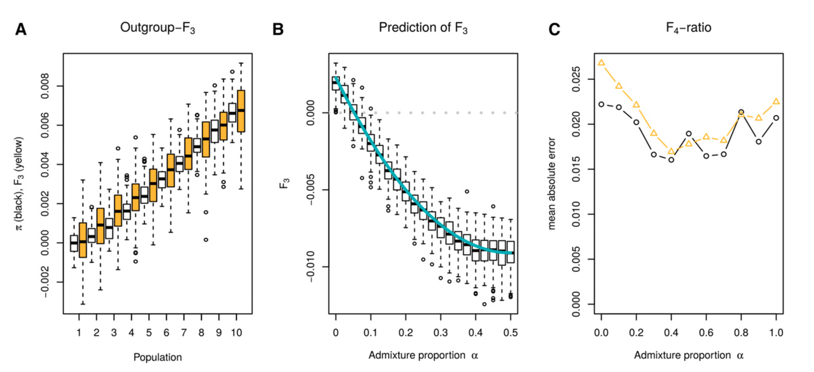

::: {.aside}
<small>Image from [Peter (2016)](https://academic.oup.com/genetics/article/202/4/1485/5930214)</small>
:::

## Developing intuition into statistics

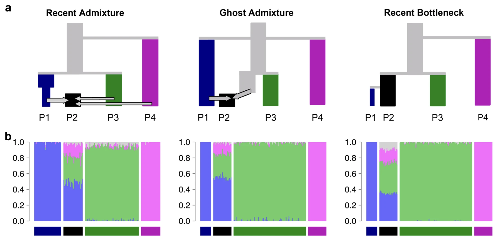

::: {.aside}
<small>Image from [Lawson _et al._ (2018)](https://www.nature.com/articles/s41467-018-05257-7)</small>
:::

## Estimating model parameters (simulation-based inference like [ABC](https://en.wikipedia.org/wiki/Approximate_Bayesian_computation))

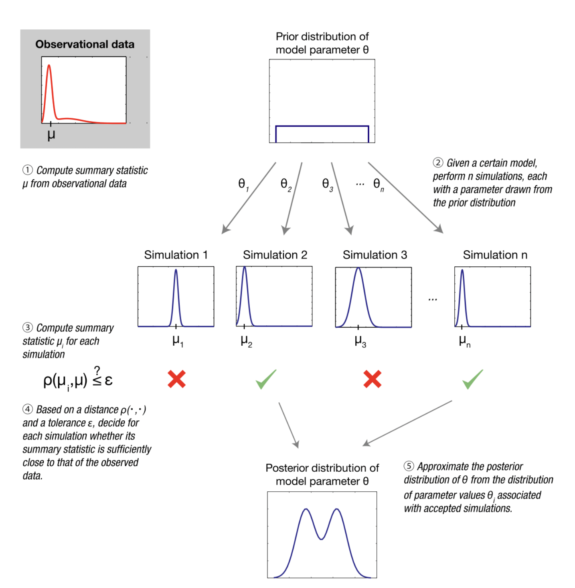{width="50%"}

::: {.aside}
<small>Image from [Wikipedia on ABC](https://en.wikipedia.org/wiki/Approximate_Bayesian_computation)</small>
:::

## Ground truth for method development

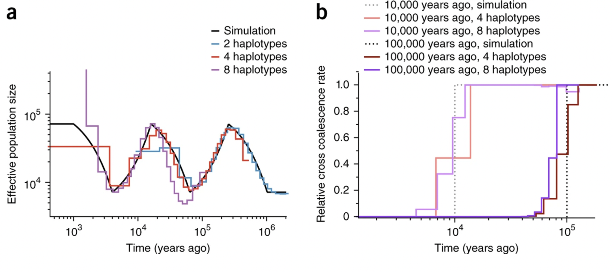

::: {.aside}
<small>Image from [Schiffels and Durbin (2014)](https://www.nature.com/articles/ng.3015)</small>
:::

#

<h2>Again, these apply to every researcher in population genomics.</h2>

. . .

 

We just haven't had the appropriate software tools.

#

<h1>We are here to learn how to do all of this.</h1>

# 

<h2>The challenge of teaching a course like this is that
our prior experiences are quite different.</h2>

## #1 teaching rule: _"know the audience"_

## #1 teaching rule: _"know the audience"_

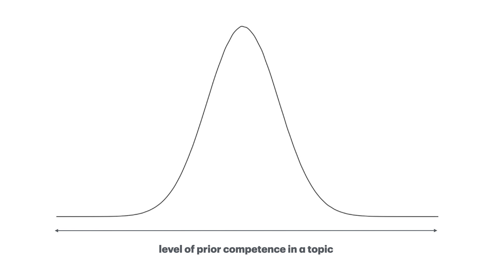

## #1 teaching rule: _"know the audience"_

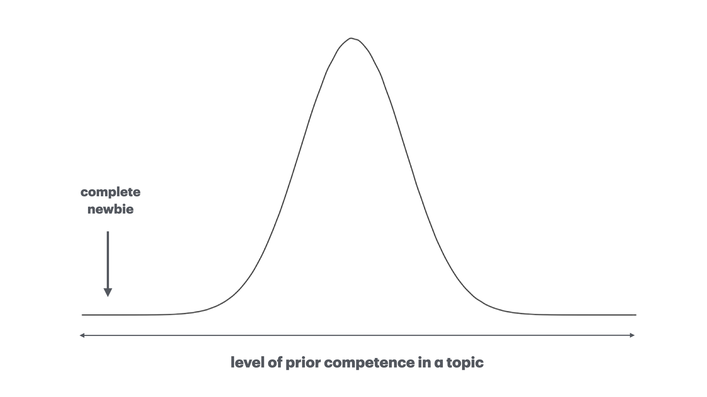

## #1 teaching rule: _"know the audience"_

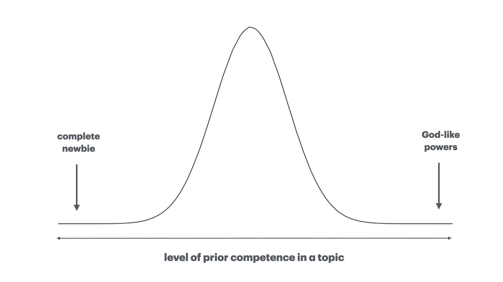

## To satisfy everyone, we would need...

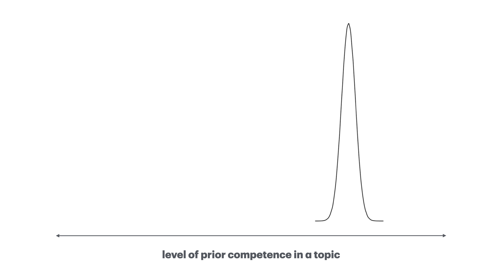

## To satisfy everyone, we would need...

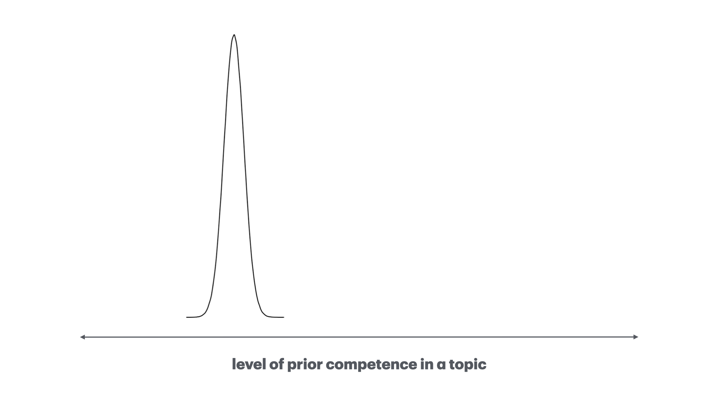

## To satisfy everyone, we would need...

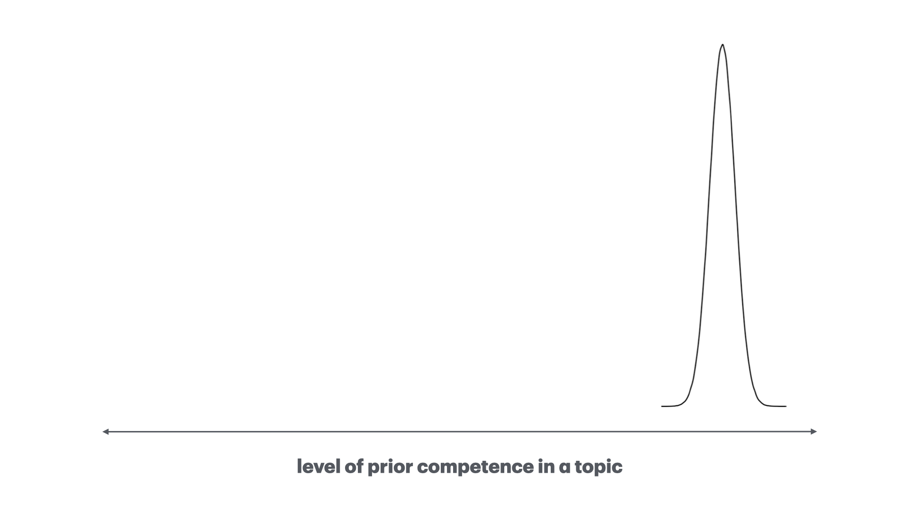

#

<h1>This is hardly possible!</h1>

 
<h2>So how did we deal with this?</h2>

 

(For real, enough of philosophizing.)

## A workshop, not lecture series

- Lectures would be guaranteed to be always boring for some
  - (regardless of any assumed "prior competence" level)

<!-- And it FORCES us to learn differently too - the less time I spend talking AT -->
<!-- you I hope gives us more time to speak TO EACH OTHER. -->

. . .

<u><b>Computing is a skill, not a knowledge to transfer!</u></b>

. . .

- Give as much time to the practical as possible:
  1. focus on hands-on exercises
  2. provide opportunities for application to your projects

. . .

- Provide comfortable space to do 1. and 2. <u>at your own pace</u>

## This workshop is also a (work)book

<h4><a href="https://bodkan.net/simgen">www.bodkan.net/simgen</a></h4>

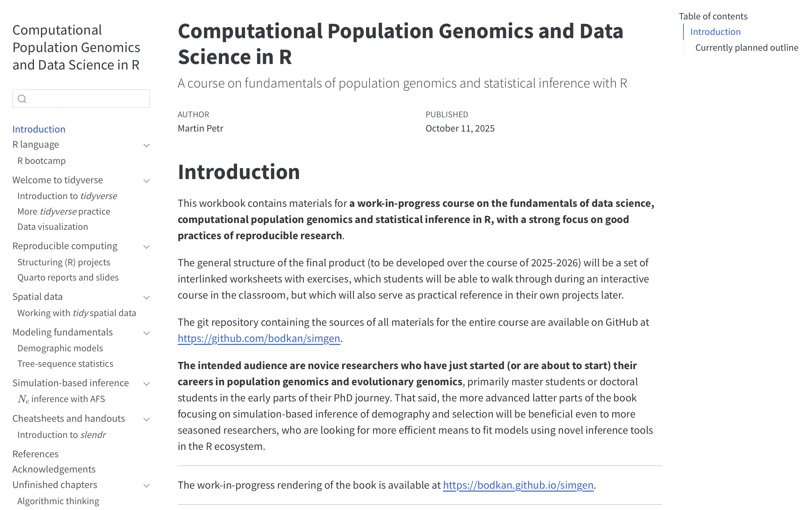{width="60%"}

Original motivation: What MSc / PhD students need to know to hit the
ground running. A future two-week course at UCPH.

## Outline of this workshop

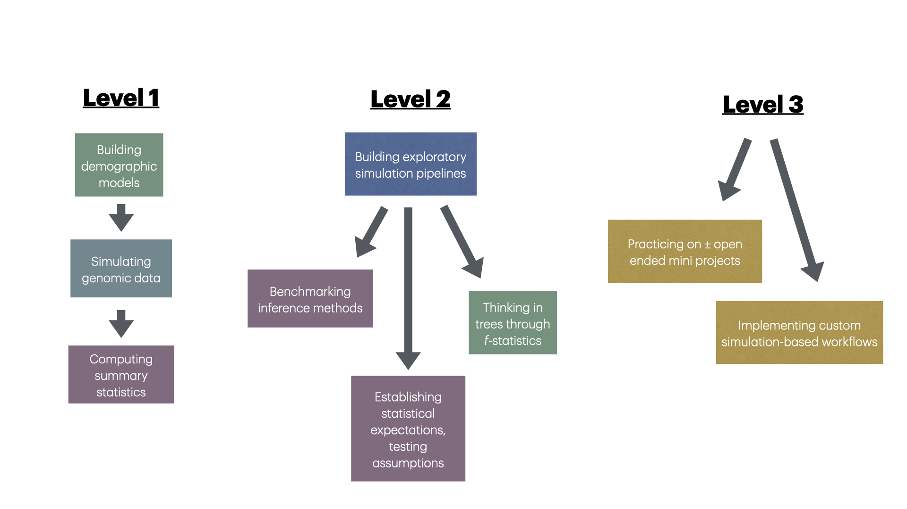

#

<h1>Target audiences</h1>

 

<h3>Tips on getting the most out of this workshop depending on your level of experience.</h3>

{width="60%"}

## If you already know a lot of popgen

- Many exercises will be easy for you, but I suggest you go through them anyway.
I really had to work hard to solve the exercises myself and learned a lot in the
process.

. . .

- Think about potential applications of any given exercise in your own teaching,
or to a research challenge you've had to face in the past (I would love to hear
your thoughts!).

. . .

- If you find yourself with extra time, consider reading through the linked
papers. We rarely have the opportunity "to just read" foundational papers.

## If you're quite new to popgen / programming

- Some of the theoretical concepts might seem abstract and unclear. This is
fine. Simulations are the best tool to learn about these concepts in a playful,
interactive way.

. . .

- There will be a lot of coding. There's no other way in computational research.
The best way to learn program is on topics of your interest (in this case,
popgen).

. . .

- Exercises will guide you through building of mental models of _real research
problems_ and solving them with code.

# An important note, regardless of your level...

## 99% of exercises are given solutions!

As you're working through exercises, you'll be seeing this:

<small>
 
</small>

. . .

This was the only way to make the workshop useful for all levels of experience
(I learned this the hard way).

 

<h2>But please, let's make a pact.</h2>

# Do not look at my solutions unless...

1. You're utterly lost.

2. You asked me (or a friend) for a hint and are still unsure.

3. Your have your solution and want to check my approach

Learning to solve any research problem is supposed to be hard and sometimes
frustrating. This is the only way to truly learn.

# When you do, don't copy-paste code blindly

1. Read my solution and figure out how it works

2. Try to write it yourself (while taking an occasional peek)

. . .

 I had to come up with each question _and_ each answer on my own. Often it
was really hard for me to!

#

<h2>I would like this workshop to be<h2><h1>interactive</h1><h2>_and_
</h2><h1>collaborative</h1>

# 

<h1>teacher ️⬇️ student</h1>

#

<h1>teacher-student ️⬆️ ⬇️ student-teacher</h1>

#

<h1>We are _all_ here to learn</h1>

 
Share your ideas!
  

Let's brainstorm about how to apply techniques from this workshop to your
ongoing (or planned) research projects, your studies, or your own teaching.

## Our time schedule

 

- 10:00-12:00 Morning session
- 12:00-14:00 Lunch break
- 14:00-16/17:00 Afternoon session

It's impossible to map each "chapter" to specific time slot because this would
require knowing how much time will each exercise take for all of you.

We'll play it by the ear.
